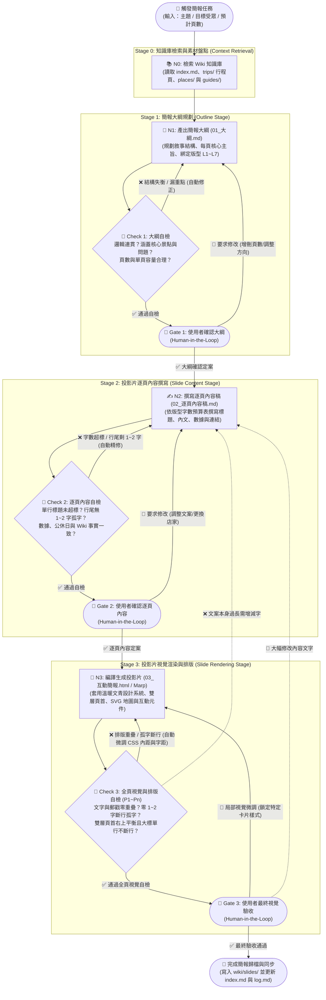

# Slide Deck Graph — 三階段投影片編譯工作流規範

本技能將「從 LLM Wiki 知識庫生成高品質投影片」定義為一個**以 Obsidian 實體 Markdown 檔案為狀態載體（File-Backed State Graph）**的三階段工作流。每次製作或大幅更新簡報時，Agent 必須依序推進 **Stage 1（大綱）➔ Stage 2（逐頁內容稿）➔ Stage 3（投影片渲染與視覺 QA）**，並在每個階段執行對應的自動檢查（Gate）與使用者確認（HITL）。

---

## 1. 投影片生成 Graph 整體流程圖 (Proposed Workflow Graph)

---

## 2. 檔案命名與雙向連動規則 (`wiki/slides/`)

每套行程簡報皆由四個連動檔案組成：
1. `wiki/slides/<旅程名稱>_01_大綱.md`：Stage 1 產物，記錄簡報設定（Brief）、總頁數、每頁版型代號（`L1`～`L7`）、章節主旨與引用的 `[[Wiki頁面]]`。
2. `wiki/slides/<旅程名稱>_02_逐頁內容稿.md`：Stage 2 產物，為**唯一文案事實來源（Single Source of Copy）**。記錄每一頁每一個欄位的定稿文字、外部連結與表格數據。
3. `wiki/slides/<旅程名稱>_互動簡報.html`：Stage 3 產物，單一檔案自包含（Self-contained）之 16:9 瀏覽器互動式簡報。
4. `wiki/slides/<旅程名稱>_Marp簡報.md`：Stage 3 產物，Marp 格式之 Markdown 投影片。

**快速重編譯入口（Re-entry Rule）**：
- 若使用者直接於 Obsidian 修改了 `01_大綱.md`，直接從 `Gate 1A ➔ Node 2` 啟動。
- 若使用者直接於 Obsidian 修改了 `02_逐頁內容稿.md`，直接從 `Gate 2A ➔ Node 3` 啟動，將最新文字編譯進 HTML 與 Marp 簡報。

---

## 3. 七大標準版型庫與「欄位字數預算表」

在 **Stage 1 (`Gate 1A`)** 檢查容器數量上限，並在 **Stage 2 (`Gate 2A`)** 嚴格執行欄位字數與行尾餘數預檢：

### 3.1 全域雙層頁首規範（`.mag-header`，適用於 `L2`～`L7`）
- **第一層（`.mag-top-row` 左右對齊，消除右上角空白）**：
  - 左側 `.mag-kicker`（日期／章節＋區域）：**18～28 字**（單行 `white-space: nowrap`）。
  - 右側 `.mag-meta-badge`（當日自駕路線／膠囊標籤）：**16～28 字**（單行 `white-space: nowrap`）。
- **第二層（`<h1>` 100% 全寬單行大標題）**：
  - 獨享 100% 寬度，字數嚴格控制在 **16～22 個中文字**，設定 `white-space: nowrap`，絕不斷成兩三行。

### 3.2 版型代號 (`L1`～`L7`) 規格總表

| 版型 ID | 版型名稱与用途 | 容器數量上限 (`Gate 1A`) | 欄位字數預算與防孤字規範 (`Gate 2A`) |
| :--- | :--- | :--- | :--- |
| **`L1_Cover`** | **雜誌封面頁** | 左標題區 × 1、左下規格卡 × 4、右拍立得視覺 × 1 | • 主標題：2 行（每行 8–12 字） • 副標題：3 行（每行 18–22 字） • 規格卡 `.spec-val`：**12–16 字（單行不換行）** |
| **`L2_Split2Col`** | **雙欄對照知識頁** | 左右大卡片 × 2（每卡 3–4 點＋底部橫幅 × 1） | • 卡片 `H3`：**12–16 字（單行）**＋右側外部連結 • `<li>` 粗體首行：**18–24 字（單行）** • `<li>` 說明行：每行約 26 字，控制在 **22–25 字（1行）** 或 **44–50 字（2行滿）**，禁止 27–29 字 |
| **`L3_MapPlus3Cards`** | **全幅地圖＋下方三欄重點卡** | 上方 SVG 地圖 × 1、下方並排小卡 × 3 | • 下方三卡 `H3`：**11–14 字（單行）** • 短列點模式：每列 **17–20 字（單行鎖定 `nowrap`，必要時微調字距 `-0.35px`）** • 段落模式：每行約 17 字，控制在 **46–50 字（3行飽滿，尾行 ≧ 6 字）** |
| **`L4_DayTimeline`** | **每日行程時間軸頁** （左 58% 時間軸＋右 42% 明信片） | 左側時間塊 **最多 4 個** 右側明信片 **最多 2 張**（可加 1 提醒橫幅） | • 時間軸粗體 `strong`：**18–26 字（單行 `nowrap`）** • 時間軸說明 `.time-desc`：每行約 30 字，控制在 **24–29 字（1行）** 或 **50–58 字（2行）**，禁止 31–33 字 • 明信片標頭 `.postcard-head`：採 **Flexbox 左右並排**（嚴禁 `position: absolute`），左 `H4` **10–13 字（單行）** ＋ 右 `.postcard-stamp` **8–12 英文字母** • 明信片內文 `p`：每行約 22 字，尾行 ≧ 6 字 |
| **`L5_Decision2Col`** | **旅伴二選一決策頁** | 左右對決大卡 × 2（含投票鈕）＋底部折衷橫幅 × 1 | • 卡片 `H3`：**12–16 字**＋右側膠囊標籤 • 每卡列點 3–4 點，每點 **36–46 字（2行飽滿）** |
| **`L6_3ColCards`** | **三欄主題圖鑑／勾選清單頁** | 並排大卡片 × 3（每卡 3–4 個項目） | • 卡片 `H3`：**9–13 字（單行）** • 勾選項 `.check-item span`：每行約 18 字，每項 **28–34 字（2行飽滿，尾行 ≧ 10 字）** |
| **`L7_TableBudget`** | **全寬結構表格頁** | 頂部人數切換器 × 1、主表格（6–8 列）＋底部橫幅 × 1 | • 表格第 1、3、4 欄：**強制單行不換行** • 表格第 2 欄（明細）：每行約 32 字，控制在 **26–31 字（1行）** 或 **52–60 字（2行）** |

---

## 4. 三階段檢查門檻 (Quality Gates Checklist)

### ✅ Gate 1A：大綱自動檢查（寫入 `01_大綱.md` 後執行）
1. **覆蓋率檢查**：行程中所有天數、航班、必去景點、餐廳、住宿是否皆已排入對應頁碼？
2. **版型容量檢查**：每頁分配的時段或卡片數是否皆 ≦ 該版型上限？
3. **時效與公休檢查**：排程是否避開已知公休日（如週二、週三）與冬季休業景點？

### ✅ Gate 2A：逐頁內容自動檢查（寫入 `02_逐頁內容稿.md` 後執行）
1. **單行標題字數檢查**：所有 `H1`（16–22字）、`H3/H4`（10–16字）、時間軸 `strong`（18–26字）是否零超標？
2. **行尾孤字數學預檢**：逐段檢視多行說明文字，除以該欄位每行字數後，是否已消除所有「餘數為 1～2 字」的句子？
3. **文字與連結衛生檢查**：確認全篇使用繁體中文（無 `与` 等簡體字），且景點/餐廳/飯店皆附 Google Maps 與官網連結。

### ✅ Gate 3A：全頁視覺排版自動檢查（產出 HTML 簡報後 P1～Pn 逐頁執行）
1. **零重疊（Zero Overlap）**：`.postcard-head` 必須使用 `display: flex; justify-content: space-between; gap: 8px;`，`.postcard-stamp` 設為 `flex-shrink: 0`，禁止使用 `position: absolute`。SVG 地圖上所有文字座標互不碰撞。
2. **零單字/雙字斷行（Zero 1–2 Char Orphans）**：
   - 對有固定排版需求的卡片（如 P3 下方三張卡片）加上 `data-lock-style="true"` 鎖定字級，並對單行列表加上 `white-space: nowrap` 與微調內距/字距，確保不會掉出單字（如「五」）。
   - 其餘動態區塊啟用 CSS `text-wrap: pretty` 與 JS `Range.getBoundingClientRect()` 視覺行掃描，若任何一行僅剩 1～2 個字（含標點 ≦ 3 字），自動微調字距合併回上一行。
3. **頁首視覺平衡（Header Balance）**：每頁上方 `.mag-header` 皆為雙層結構，右上角有膠囊標籤平衡版面，下方 `H1` 為單行全寬。
