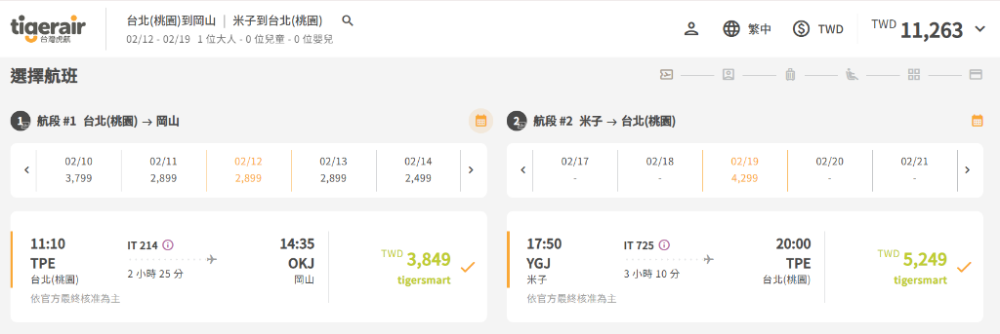
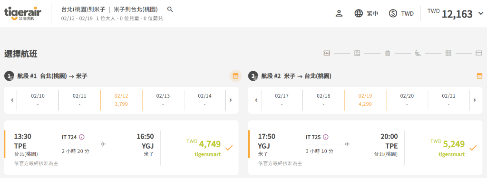

# 2027/02/12 – 02/19 台灣虎航山陰候選航班資訊（搭配自駕）

- **擷取日期**：2026-11-10
- **航空公司**：台灣虎航 (Tigerair Taiwan)
- **旅遊日期**：2027/02/12（五）～ 2027/02/19（五）
- **人數**：1 位大人（查詢基準價）
- **預計當地交通方式**：租車自駕

---

## 方案 A：岡山進、米子出（不同點進出）

- **去程（02/12 五）**：`IT 214` 台北(桃園 TPE) **11:10** → 岡山(OKJ) **14:35**（飛行時間 2 小時 25 分）
  - 票價（tigersmart）：TWD 3,849
- **回程（02/19 五）**：`IT 725` 米子(YGJ) **17:50** → 台北(桃園 TPE) **20:00**（飛行時間 3 小時 10 分）
  - 票價（tigersmart）：TWD 5,249
- **含稅總計**：**TWD 11,263**

---

## 方案 B：米子進、米子出（單點直飛進出）

- **去程（02/12 五）**：`IT 724` 台北(桃園 TPE) **13:30** → 米子(YGJ) **16:50**（飛行時間 2 小時 20 分）
  - 票價（tigersmart）：TWD 4,749
- **回程（02/19 五）**：`IT 725` 米子(YGJ) **17:50** → 台北(桃園 TPE) **20:00**（飛行時間 3 小時 10 分）
  - 票價（tigersmart）：TWD 5,249
- **含稅總計**：**TWD 12,163**
- **與方案 A 價差**：貴 TWD 900 / 人
